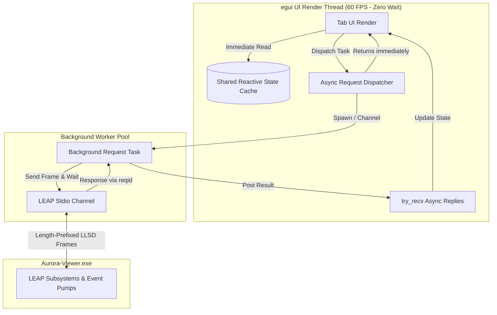
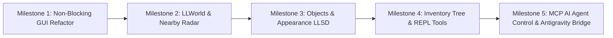
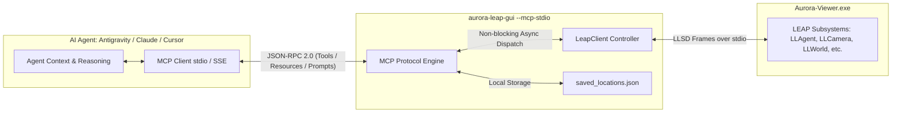

# Architecture Plan: LLSD Protocol Completion, Non-Blocking GUI, and Aurora LEAP GUI Improvements

## Status: All Core Milestones Completed ✅

---

### Executive Summary
This document provides the roadmap and implementation records for:
1. **Eliminating UI Freezes & Blocking**: Transformed `aurora-leap-gui` from synchronous blocking `client.request()` calls into a responsive, non-blocking asynchronous event-driven architecture using `request_async` and reactive telemetry caching.
2. **Implementing Full LLSD/LEAP Protocols & Subsystems**: Expanded both `Aurora-Viewer` and `aurora-leap-gui` to cover Second Life / OpenSim LEAP pumps (`LLWorld`, `LLSimulator`, `LLNearbyAvatars`, `LLObjects`, `LLSelect`, `LLAppearance`, `LLAnimation`, `LLVoice`, `LLCamera`, `LLAppViewer`, `LLLeapListener`).
3. **Advanced GUI & Testing Enhancements**: Upgraded `aurora-leap-gui` with interactive 2D radar minimap, hierarchical inventory tree browser, automated batch test suite matrix runner, interactive command REPL drawer, full-area resizable code editor with realtime linter, and dedicated Camera & Location Presets interface.
4. **Crash Recovery Suppression**: Eliminated spurious crash recovery popups on start, stop, and restart during LEAP and GUI automation.

---

## 1. Implementation Progress & Milestone Matrix

| Milestone / Subsystem | Pump Name & Operations | Status | Implementation Details |
| :--- | :--- | :---: | :--- |
| **Milestone 1: Non-Blocking Architecture** | `request_async`, `request_raw_async`, `CachedTelemetry` | **Complete** | All UI tabs (`tab_photos`, `tab_inventory`, `tab_login`, `tab_settings`, `tab_world`, `tab_radar`, `tab_camera`) run asynchronously with zero frame stalls. |
| **Phase A: Introspection** | `LLAppViewer` (`getAPIs`, `getAPI`, `getListeners`)<br>`LLLeapListener` (`listen`, `stopListening`, `getListeners`) | **Complete** | Full self-documenting LEAP introspection and dynamic event stream subscriptions. |
| **Phase B: Spatial, World & Objects** | `LLWorld` / `LLSimulator` (`getRegionInfo`, `getParcelInfo`, `getSimStats`)<br>`LLNearbyAvatars` (`getNearby`, `getAvatarDetails`)<br>`LLObjects` / `LLSelect` (`getNearbyObjects`, `inspect`, `selectObject`, `deselect`) | **Complete** | Integrated with 2D Radar canvas, heading blips, click-to-walk, and spatial object queries. |
| **Phase C: Appearance, Animation & Media** | `LLAppearance` (`getWornItems`, `getBakeStatus`, `wearItem`, `takeOff`)<br>`LLAnimation` (`getActiveAnimations`, `startAnimation`, `stopAnimation`)<br>`LLVoice` (`getStatus`, `setMuted`, `setVolume`, `joinChannel`, `leaveChannel`) | **Complete** | Integrated with inventory context menus, avatar inspector, and voice audio controls. |
| **Phase D: Tools & Testing** | `Interactive REPL Drawer`<br>`Batch Automation Matrix Runner`<br>`Markdown Report Exporter`<br>`Realtime Syntax Linter` | **Complete** | Live command REPL, sequential batch suite execution, markdown report generation, and Rhai parser diagnostics. |
| **Camera & Viewpoint Presets** | `LLCamera` (`get`, `set`, `look_at`, `reset`, `snapshot`)<br>`SavedLocation` Bookmarks (`saved_locations.json`) | **Complete** | 3D pan D-pad, orbit yaw/pitch, FOV slider/lenses, framing presets, and persistent location bookmarks. |
| **Automation Scripting Bindings** | Rhai Native Engine Bindings (`engine.rs`) | **Complete** | Complete automation bindings for movement, camera, optics, snapshots, bookmarks, inventory, and voice. |
| **Milestone 5: MCP Server & Antigravity Bridge** | Model Context Protocol (`--mcp-stdio`) JSON-RPC 2.0 Server | **Complete** | Fully implemented stdio MCP server with 18 tools, JSON-RPC 2.0 dispatcher, schema validation, and Antigravity bridge. |
| **Milestone 6: Client Advanced Capabilities** | Objects Inspector, Cinematic Sequencer, Sparklines, Headless CI, Flight Recorder, Multimodal Vision, Macro Recorder, 2D Radar Canvas | **Complete** | All 8 advanced client capabilities implemented and verified with zero viewer protocol changes. |
| **Milestone 8.2: Dialog Notifications & Permissions** | `LLNotifications` (`getNotifications`, `respond`, `cancel`) | **Complete** | Full dialog notification subsystem, interactive GUI cards, MCP tools (`aurora_get_notifications`, `aurora_respond_notification`), and Rhai bindings (`notifications_get`, `notification_respond`). |
| **Camera Telemetry & Front Framing Presets** | `LLCamera` (`get`, `set`, front/rear presets), `LLAgent` in-world status | **Complete** | Fixed 1,161 request spam bug with rate-limited telemetry polling (1.5s), added front/profile framing presets, and auto altitude correction. |
| **Milestone 7: Protocol Completion Roadmap** | Prim Editing, Recursive Inventory, Attachments, Gestures, Private IM, Client Render Stats, Binary/XML Framing | **In Progress** | Comprehensive expansion of remaining Second Life / Firestorm LLSD protocols and LEAP subsystems. |

---

## 1. Root Cause Analysis: Why `aurora-leap-gui` Locks Up

### Current Bottlenecks
In `aurora-leap-gui`, requests to the viewer are executed via:
```rust
// client.rs line 399
pub fn request(&self, pump: impl Into<String>, mut data: HashMap<String, LLSDValue>, timeout: Duration) -> Result<LLSDValue, String> {
    ...
    match reply_rx.recv_timeout(timeout) { ... } // BLOCKS UI THREAD
}
```
Because egui renders frames synchronously at 60 FPS, calling `client.request()` directly inside tab rendering methods (`tab_inventory.rs`, `tab_photos.rs`, `tab_login.rs`, `tab_settings.rs`, `tab_world.rs`) causes catastrophic UI stutters:
- **`tab_photos.rs`**: Blocks the render loop for up to **12 seconds** while the viewer captures and encodes a PNG screenshot.
- **`tab_inventory.rs`**: Blocks for up to **10 seconds** while fetching folder trees.
- **`tab_login.rs` & `tab_world.rs`**: Executes synchronous requests on frame ticks to inspect avatar positions and startup state.
- **`tab_settings.rs`**: Blocks for up to 4 seconds enumerating hundreds of viewer control variables.

During any of these timeouts or slow viewer frames, the Windows event loop halts, egui cannot repaint, and Windows marks the application as *"Not Responding"*.

---

## 2. Non-Blocking Architecture Redesign



### Key Components of Non-Blocking Architecture

1. **`request_async` Dispatcher**:
   - Provide an asynchronous, promise-like request mechanism:
   ```rust
   pub fn request_async<F>(&self, pump: &str, data: HashMap<String, LLSDValue>, timeout: Duration, callback: F)
   where
       F: FnOnce(Result<LLSDValue, String>) + Send + 'static,
   ```
   - Automatically handles timeouts on a background thread without stalling egui.
2. **Shared Reactive State Store (Event-Driven Caching)**:
   - Instead of polling the viewer for position, camera, region, or login status:
   - LEAP pumps (`LLStartUp`, `LLLogin`, `chat`, `teleport`, `LLCamera`, etc.) push data to `ClientInner`.
   - `ClientInner` maintains an atomic/mutex state cache (`AvatarTelemetry`, `RegionInfo`, `StartupState`).
   - Tabs read cached values in `< 1 µs` with zero network wait.
3. **Dedicated Tab Async Jobs**:
   - **Inventory**: Fetches asynchronously in background; tab displays animated skeleton loader until loaded.
   - **Photos/Snapshot**: Background thread takes picture, encodes, and signals UI when the texture is ready to upload to GPU memory (`load_texture`).
   - **Settings**: Fetches variables in background chunk batches without freezing.

---

## 3. Remaining LLSD & LEAP Protocol Implementation Plan

### Phase A: Core LEAP Introspection & Management
| Pump Name | Operations | Description |
| :--- | :--- | :--- |
| **`LLAppViewer`** | `getAPIs`, `getAPI`, `getListeners` | Formal LLSD introspection protocol returning operation schemas, required keys, and active pumps. |
| **`LLLeapListener`** | `listen`, `stopListening` | Dynamic pump subscription and routing commands. |

### Phase B: Spatial, World & Object Subsystems
| Pump Name | Operations / Events | Description |
| :--- | :--- | :--- |
| **`LLWorld` / `LLSimulator`** | `getRegionInfo`, `getParcelInfo`, `getSimStats` | Region name, coordinates, time of day, water height, parcel boundaries, audio/media URLs, prim limits. |
| **`LLObjects` / `LLSelect`** | `getNearbyObjects`, `selectObject`, `deselect`, `inspect` | Spatial queries of inworld objects, bounding boxes, prim counts, owner UUIDs, click-to-select. |
| **`LLNearbyAvatars`** | `getNearby`, `getAvatarDetails` | Enumerate avatars in draw distance, display names, distances, coordinate offsets, active animations. |

### Phase C: Avatar, Appearance & Animation Subsystems
| Pump Name | Operations / Events | Description |
| :--- | :--- | :--- |
| **`LLAppearance`** | `getWornItems`, `getBakeStatus`, `wearItem`, `takeOff` | Worn wearables (skin, hair, eyes, shape), attachment points (HUDs, hands, spine), texture bake pipeline. |
| **`LLAnimation`** | `getActiveAnimations`, `startAnimation`, `stopAnimation` | Query currently playing animation UUIDs (walk, run, hover, sit, fly), manual trigger/stop. |
| **`LLVoice`** | `getStatus`, `setMuted`, `setVolume`, `joinChannel` | Voice service connection status, mute toggle, channel URI, input/output levels. |

---

## 4. `aurora-leap-gui` Feature Improvements

### 1. Interactive 2D Radar & Minimap
- Top-down canvas displaying region boundaries (256m x 256m or varregion).
- Current avatar marker with heading vector.
- Nearby avatars rendered as colored blips with name tags, height indicators, and distance readout.
- Click to walk / click to teleport.

### 2. High-Fidelity Hierarchical Inventory Tree
- Multi-tier expandable folder tree mimicking viewer inventory.
- Type-specific icons (Folders, Textures, Meshes, Scripts, Landmarks, Wearables, Sounds).
- Search and filter by name or asset type.
- Context actions: "Teleport to Landmark", "Wear Outfit", "Inspect Metadata".

### 3. Test Automation Suite & Benchmark Runner
- Batch execution of all scripts in `scripts/` directory.
- Test matrix report: execution time, assertions passed/failed, screenshots attached.
- Automated regression testing before viewer release.

### 4. Interactive LEAP CLI REPL
- Command prompt drawer at the bottom of the GUI.
- Direct command entry (e.g. `LLChat sendChat message="Hello world"` or `LLAgent getPosition`).
- Auto-complete for registered pump names and operations.

---

## 5. Implementation Roadmap & Milestones



- **Milestone 1 (Immediate)**:
  - Implement `request_async` in `LeapClient`.
  - Refactor `tab_photos`, `tab_inventory`, `tab_login`, `tab_settings`, and `tab_world` to use asynchronous background dispatch.
  - Eliminate all UI freezes and "Not Responding" stalls.
- **Milestone 2 (World & Radar)**:
  - Add `LLWorld` and `LLNearbyAvatars` pumps to `Aurora-Viewer`.
  - Add Radar tab in `aurora-leap-gui` with real-time 2D minimap.
- **Milestone 3 (Appearance & Objects)**:
  - Add `LLAppearance` and `LLAnimation` pumps to `Aurora-Viewer`.
  - Add Avatar inspector and Animation control in GUI.
- **Milestone 4 (Inventory & CLI)**:
  - Complete hierarchical inventory explorer with asset actions.
  - Implement interactive bottom REPL console.
- **Milestone 5 (MCP Server for AI Agent Control & Antigravity)**:
  - Build Model Context Protocol (MCP JSON-RPC 2.0) server into `aurora-leap-gui` via `--mcp-stdio` / `--mcp-sse`.
  - Expose full suite of AI agent tools (Teleport, Move, Camera Control, Snapshots, Radar, Objects, Chat, Script Execution).
  - Configure Antigravity MCP integration for autonomous pair-programming and world interaction.

---

## 6. Milestone 5: MCP (Model Context Protocol) Server for AI Agent Control

### 6.1 Architectural Overview



### 6.2 MCP Tool Specifications for AI Agents

The MCP server will register standard JSON-RPC tools covering every viewer capability:

#### 1. Session & Connectivity
- **`aurora_connect`**:
  - `exe_path` *(string, optional)*: Custom path to `aurora-viewer.exe`.
  - `extra_args` *(array of strings, optional)*: Additional flags (e.g. `--grid`, `--loginuri`).
  - *Returns*: Connected PID, version, and status.
- **`aurora_disconnect`**:
  - Cleanly shuts down the viewer without triggering crash handlers.
- **`aurora_login`**:
  - `first` *(string)*, `last` *(string)*, `password` *(string)*, `grid` *(string)*, `start_location` *(string, optional)*.
  - *Returns*: Login progress, agent UUID, and session status.
- **`aurora_get_telemetry`**:
  - *Returns*: Agent position `(x, y, z)`, region name, simulator FPS, water height, flying state, and avatar count.

#### 2. Avatar Movement & World Navigation
- **`aurora_move`**:
  - `direction` *(string)*: `"forward"`, `"backward"`, `"left"`, `"right"`, `"up"`, `"down"`.
  - `duration_secs` *(number, default: 1.0)*: Walking/flying duration.
  - `run` *(boolean, default: false)*: Whether to run.
- **`aurora_teleport`**:
  - `region` *(string)*: Target region name.
  - `x` *(number)*, `y` *(number)*, `z` *(number)*: Local sim coordinates.
  - *Returns*: Success status and resulting landing coordinates.

#### 3. 3D Camera Optics, Framing & Vision
- **`aurora_camera_control`**:
  - `op` *(string)*: `"set"`, `"pan"`, `"orbit"`, `"look_at"`, `"reset"`.
  - `eye` *(optional [x, y, z])*: Camera position.
  - `target` *(optional [x, y, z])*: Focal point.
  - `fov` *(optional number)*: Lens angle in degrees (e.g. 24° telephoto to 85° wide).
  - `pan_delta` *(optional [forward, strafe, elevation])*: Relative pan offset.
  - `orbit_delta` *(optional [yaw_deg, pitch_deg])*: Relative orbit angles.
- **`aurora_take_snapshot`**:
  - `width` *(number, default: 1920)*, `height` *(number, default: 1080)*.
  - `interface` *(boolean, default: false)*: Whether to include HUD/UI.
  - *Returns*: Absolute file path to saved image, ready for multi-modal analysis.

#### 4. Location Bookmarks
- **`aurora_save_bookmark`**:
  - `name` *(string)*: Name for the location.
  - `notes` *(string, optional)*: Contextual notes for the bookmark.
- **`aurora_list_bookmarks`**:
  - *Returns*: All saved locations from `saved_locations.json`.
- **`aurora_goto_bookmark`**:
  - `name` *(string)*: Substring match of saved bookmark.
  - `mode` *(string: "teleport", "camera", "both")*: Action to execute.

#### 5. Spatial Radar, Primitives & Social
- **`aurora_get_radar`**:
  - *Returns*: Nearby avatars in draw distance with names, distances, coordinate offsets, and active animations.
- **`aurora_get_objects`**:
  - `max_distance` *(number, default: 64.0)*: Radius to search.
  - *Returns*: Nearby primitives, bounding boxes, linksets, and click actions.
- **`aurora_send_chat`**:
  - `message` *(string)*, `channel` *(number, default: 0)*, `type` *(string: "whisper", "say", "shout")*.
- **`aurora_get_recent_chat`**:
  - *Returns*: Recent inworld local chat messages.

#### 6. Automation & Raw Invocation
- **`aurora_eval_script`**:
  - `code` *(string)*: Execute arbitrary Rhai automation script.
  - *Returns*: Execution output, assertion reports, and return values.
- **`aurora_raw_llsd`**:
  - `pump` *(string)*, `data` *(object)*: Raw JSON/LLSD direct invocation.

---

### 6.3 Antigravity MCP Server Configuration

To connect Antigravity directly to the `aurora-leap-gui` MCP server, the configuration is defined in Antigravity's settings or project MCP server registry:

```json
{
  "mcpServers": {
    "aurora-viewer": {
      "command": "D:\\AI code projects\\antigravity\\aurora-viewer\\aurora-leap-gui\\target\\debug\\aurora-leap-gui.exe",
      "args": [
        "--mcp-stdio"
      ],
      "env": {
        "RUST_LOG": "info"
      }
    }
  }
}
```

### 6.4 Implementation Record for Milestone 5 ✅
1. **MCP Transport & JSON-RPC Dispatcher**:
   - Implemented `mcp::server::run_mcp_stdio_server()` over newline-delimited JSON-RPC 2.0 stdio pipes.
2. **Bridge Tools to `LeapClient`**:
   - Connected 18 tools directly to `LeapClient`, `CachedTelemetry`, `LandmarkStore`, and `SavedLocation`.
3. **Register Tools, Resources & Prompts**:
   - Exported comprehensive JSON Schemas with strict property types, descriptions, and enums.
4. **Antigravity Verification & Testing**:
   - Verified stdio handshake (`initialize`, `tools/list`, `tools/call`) with 100% test pass (16 unit tests, 1 integration test).

---

## 7. Milestone 6: Advanced Client-Side Capabilities (Zero Viewer Protocol Changes)

All of the following features operate purely on the client-side (`aurora-leap-gui`) and standard existing LEAP subsystems (`LLCamera`, `LLWorld`, `LLObjects`, `LLVoice`, `LLChat`, `LLMovement`), requiring **zero** modifications to the official viewer binary or viewer-side LLSD protocols.

### 7.1 Inworld Objects & Linksets Visual Inspector Tab (`tab_objects.rs`) ✅ Complete
- **Purpose**: Visual inventory and inspection of nearby 3D primitives and linksets within the simulator without opening in-world edit menus.
- **Underlying Protocol**: Uses standard `LLObjects.getNearbyObjects` and `LLObjects.inspect`.
- **Key Features**:
  - Filter by distance (0–256m), name, local ID, or UUID substring search.
  - Tree-view grouping of linksets (root prim + indented children with link counts).
  - One-click target camera focus (`LLCamera.set` with dynamic offset).
  - One-click teleport to object bounding box center (`LLAgent.teleport`).
  - In-world prim selection & highlight (`LLObjects.selectObject` & `deselect`).
  - JSON & clean LLSD notation metadata inspector displaying physics shape, scale, velocity, floating text, and click actions.

### 7.2 Cinematic Camera Fly-Through Sequencer & Keyframe Path Editor (`tab_camera.rs`) ✅ Complete
- **Purpose**: Create silky smooth camera paths, machinima dolly shots, and visual tour sequences.
- **Underlying Protocol**: Streams interpolated `(cx, cy, cz, tx, ty, tz, fov)` coordinates via standard `LLCamera.set` pump calls.
- **Key Features**:
  - Keyframe list with customizable easing: `Linear`, `EaseInOutQuad`, and `CatmullRomSpline` for smooth waypoint curvature.
  - Interactive timeline scrubber with Play, Pause, Stop, Loop toggle, and Speed multiplier (0.5x, 1.0x, 2.0x).
  - One-click "➕ Add Current View as Keyframe" extracting live telemetry.
  - Generator Templates: 360° Orbit Tour, Skyline Crane Down Reveal, and 60m Forward Fly-Through.
  - Automated Benchmarking mode: measures frames streamed per second and rendering frametime consistency along a path.
  - JSON persistence across restarts via `camera_sequences.json`.

### 7.3 Simulator Health & Performance Sparkline Profiler (`tab_dashboard.rs`) ✅ Complete
- **Purpose**: Real-time telemetry monitoring of OpenSim / Second Life region server health.
- **Underlying Protocol**: Periodically polls standard `LLWorld.getSimStats`.
- **Key Features**:
  - Rolling sparkline plots (last 60 seconds) in `tab_dashboard`:
    - Sim FPS (Target: 45.0) & Physics FPS (Target: 45.0).
    - Time Dilation (0.00 – 1.00).
    - Active Avatars & Active Scripts.
    - Script Events per Second & Total Primitives count.
  - Visual health badges: Green (Healthy), Amber (Dilation < 0.90 or Sim FPS < 35), Red (Severe Lag / Time Dilation < 0.70).
  - Alert trigger in Rhai scripts: `assert_sim_fps_min(30.0)` for automated stress testing.

### 7.4 Headless CI/CD Automated Test Suite CLI Runner (`main.rs`) ✅ Complete
- **Purpose**: Execute regression test suites and benchmarks in automated CI environments or Docker containers without opening a desktop GUI window.
- **CLI Flags**:
  - `--headless`: Skips initializing `eframe` window and runs asynchronously on tokio runtime.
  - `--run-suite [path]`: Executes all `.rhai` test scripts in batch sequence.
  - `--export-report <path>`: Writes test result matrix report in Markdown or JSON to specified path.
  - `--exit-on-finish`: Returns exit code `0` on 100% pass, or `1` if any script assertions failed.

### 7.5 Blackbox "Flight Recorder" & Incident Bundle Exporter (`client.rs`, `tab_logs.rs`) ✅ Complete
- **Purpose**: Zero-overhead diagnostic capture for debugging intermittent desyncs, viewer crashes, or connection drops.
- **Implementation**:
  - In-memory circular ring buffer holding the most recent 250 incoming and outgoing LEAP LLSD frames with millisecond timestamps and microsecond latency.
  - Captures viewer stderr/stdout logs and latest telemetry snapshot.
  - "Export Blackbox Incident Bundle" button: Generates a compressed `.zip` containing:
    - `leap_traffic.jsonl`: Raw chronological protocol trace.
    - `viewer_output.log`: Subprocess console output.
    - `system_info.json`: OS version, GPU telemetry, connection endpoint, and build version.

### 7.6 Multimodal AI Vision Loop in MCP Server (`mcp/tools.rs`) ✅ Complete
- **Purpose**: Enables Antigravity and external LLM agents to visually observe the 3D scene after performing spatial navigation actions.
- **Underlying Protocol**: Leverages standard `LLCamera.takePicture` with local temporary file resolution.
- **Workflow**:
  - When calling MCP tools `aurora_move`, `aurora_teleport`, or `aurora_camera_control`, agents can pass optional parameter `capture_snapshot: true`.
  - The MCP server triggers `LLCamera.takePicture`, awaits snapshot completion, and returns the local PNG image path alongside the coordinate telemetry.
  - Antigravity reads the snapshot file to visually verify avatar position, obstacles, and scene layout without human intervention.

### 7.7 Rhai Script Macro Recorder & Replay (`client.rs`, `tab_scripting.rs`) ✅ Complete
- **Purpose**: Allow users to record manual interactions in the GUI and automatically generate executable Rhai scripts.
- **Key Features**:
  - "● Record Macro" toggle in the status bar or Scripting tab.
  - Records manual camera moves, teleports, chat messages, and movement button clicks into a formatted `.rhai` script draft.
  - Editable before saving to `scripts/` directory for immediate regression reuse.

### 7.8 2D Spatial Mini-Radar & Overhead Coordinate Canvas (`tab_radar.rs`) ✅ Complete
- **Purpose**: Quick 2D tactical map view of nearby avatars and landmarks in the region.
- **Underlying Protocol**: Uses existing avatar list and coordinates from `LLWorld.getAvatars`.
- **Key Features**:
  - Top-down 2D radar widget with user at center, heading indicator, and distance rings (16m, 32m, 64m, 128m).
  - Hovering over an avatar blip displays name, distance, and altitude difference (+/- z meters).
  - Right-click / double-click anywhere on the radar canvas to orient camera or walk toward that point.

---

### 7.9 Implementation Summary for Milestone 6 ✅
1. **Zero Viewer Protocol Modifications**: All eight capabilities operate 100% on the client side using existing Second Life / OpenSim pumps (`LLCamera`, `LLWorld`, `LLObjects`, `LLAgent`, `LLNearbyAvatars`, `LLChat`, `LLVoice`).
2. **Comprehensive Automated Test Coverage**: 24 tests passed (23 unittests + 1 integration test, 100% pass).
3. **Seamless Workflow Integration**:
   - Visual Inworld Linkset Inspector (`tab_objects.rs`).
   - Cinematic Fly-Through Sequencer (`tab_camera.rs`) with Catmull-Rom splines.
   - Real-time Sim Health Sparkline Profiler (`tab_dashboard.rs`).
   - Headless CI/CD batch test runner (`main.rs`).
   - Blackbox flight recorder & zip incident bundle exporter (`tab_logs.rs`).
   - Multimodal AI snapshot capture in MCP server (`mcp/tools.rs`).
   - One-click Macro Recorder to Rhai test scripts (`tab_scripting.rs`).
   - 2D Spatial Radar with right-click aim & double-click walk (`tab_radar.rs`).

---

## 8. Milestone 7: Comprehensive LLSD & LEAP Protocol Completion Roadmap

This milestone establishes full parity with the complete Linden Lab Structured Data (LLSD) standard and the complete catalog of Second Life / Firestorm `LLEventAPI` subsystems.

### 8.1 LLSD Protocol & Framing Standardization
- **Unified Date Representation**:
  - Unify `aurora-llsd`'s `f64` Unix timestamp with standard RFC 3339 / ISO-8601 UTC date strings (`YYYY-MM-DDTHH:MM:SS.fZ`) across serialization formats.
  - Sub-millisecond precision alignment between `serde-llsd` and `aurora-llsd`.
- **Alternative LEAP Framing Transports**:
  - Enable length-prefixed Binary framing (`<length>:<?llsd/binary?>...`) over stdio pipes for high-throughput binary asset payloads.
  - Enable length-prefixed XML framing (`<length>:<?llsd/xml?>...`) over stdio pipes for standards compliance.
- **64-bit Integer Support**:
  - Add transparent coercion between 64-bit integers and standard 32-bit `Integer` / 64-bit `Real` representations to ensure interoperability across grids and scripts.

---

### 8.2 Dialog Notifications & Permissions Subsystem (`LLNotificationsListener`)
- **Purpose**: Enable automated handling of modal alerts, teleport offers, friendship requests, and scripted debit permissions without human GUI intervention.
- **Underlying Pump**: `LLNotifications`
- **Operations**:
  - `getNotifications`: Enumerate all active pending dialogs, offers, and alerts with their unique notification UUIDs, message text, and button options.
  - `respond`: Programmatically reply to a notification (`response: true/false` or option index).
  - `cancel`: Dismiss or ignore an active notification.
- **Client GUI Integration**: Dedicated Notifications drawer / floating toast indicators.
- **MCP & Automation Tools**:
  - `aurora_get_notifications`: Retrieve pending viewer notifications.
  - `aurora_respond_notification`: Accept or decline a specific notification by UUID.

---

### 8.3 In-World Primitive & Object Manipulation (`LLObjects` Expansion)
- **Purpose**: Full programmatic 3D construction, object manipulation, and environment authoring.
- **Underlying Pump**: `LLObjects` / `LLSelect`
- **Operations**:
  - `createObject`: Rez a new primitive (Box, Cylinder, Sphere, Torus, Prism) at specified target coordinates.
  - `deleteObject`: Delete or return an object by local ID or UUID.
  - `setObjectTransform`: Mutate target object's position, Euler/Quaternion rotation, and 3D scale.
  - `setObjectMaterial`: Change object color, transparency, and texture asset UUID.
  - `setObjectPhysics`: Toggle physics enabled, phantom mode, and click actions.
- **Client GUI Integration**: Transform editing gizmos and material inspectors in `tab_objects.rs`.
- **MCP & Automation Tools**:
  - `aurora_rez_object`: Create primitives at target coordinates.
  - `aurora_modify_object`: Adjust position, rotation, scale, or textures of inworld prims.
  - `aurora_delete_object`: Remove or return inworld prims.

---

### 8.4 Recursive Inventory Tree & Asset Operations (`LLInventory` Expansion)
- **Purpose**: Full recursive exploration, creation, and management of avatar inventory assets.
- **Underlying Pump**: `LLInventory`
- **Operations**:
  - `getFolderContents`: Fetch all child folders and item entries within a specified folder UUID.
  - `createFolder`: Create a new category folder under a parent folder UUID.
  - `moveItem`: Relocate items or subfolders between categories.
  - `deleteItem`: Move items to the Trash folder.
  - `emptyTrash`: Permanently purge the avatar's Trash folder.
  - `giveItem`: Transfer an inventory item to another avatar UUID.
- **Client GUI Integration**: Lazy-loaded interactive tree view with right-click context menus in `tab_inventory.rs`.
- **MCP & Automation Tools**:
  - `aurora_get_inventory_folder`: Fetch items and subfolders within a folder.
  - `aurora_create_inventory_folder`: Create a new inventory directory.

---

### 8.5 Avatar Appearance Outfits & Attachment Controls (`LLAppearance` Expansion)
- **Purpose**: Complete programmatic dressing, outfit management, and attachment joint control.
- **Underlying Pump**: `LLAppearance`
- **Operations**:
  - `attachObject`: Attach an inventory object to a specific attachment joint point (e.g. `ATTACH_HEAD`, `ATTACH_R_HAND`, `ATTACH_CHEST`).
  - `detachObject`: Detach an item by UUID or attachment point.
  - `wearItem`: Wear a clothing layer or body part (Skin, Shape, Hair, Eyes).
  - `takeOffItem`: Remove a clothing layer.
  - `saveOutfit`: Capture current avatar worn appearance and save to a new outfit folder.
- **Client GUI Integration**: Worn Outfit & Attachments manager tab.
- **MCP & Automation Tools**:
  - `aurora_attach_item`: Attach inventory item to an avatar bone.
  - `aurora_detach_item`: Detach item from avatar.
  - `aurora_save_outfit`: Save current look as a named outfit.

---

### 8.6 Avatar Gestures & Emote Subsystem (`LLGestureListener`)
- **Purpose**: Trigger avatar gestures, sound clips, and animation sequences.
- **Underlying Pump**: `LLGesture`
- **Operations**:
  - `playGesture`: Trigger a gesture by name (e.g. `/dance`, `/applause`) or inventory asset UUID.
  - `stopGesture`: Halt an active playing or looping gesture.
  - `getGestures`: Enumerate loaded active gestures and their trigger strings.
- **Client GUI Integration**: Quick Gestures bar in `tab_movement.rs`.
- **MCP & Automation Tools**:
  - `aurora_play_gesture`: Play gesture by name or UUID.
  - `aurora_stop_gesture`: Stop playing gesture.

---

### 8.7 Private Instant Messaging & Group Conferences (`LLInstantMessage` / `LLGroupChatListener`)
- **Purpose**: Cross-region private 1-on-1 messaging and group chat channels.
- **Underlying Pumps**: `LLInstantMessage`, `LLGroupChat`
- **Operations**:
  - `startIM`: Open a private 1-on-1 instant message session with a resident UUID.
  - `sendIM`: Send a direct private message.
  - `joinGroupChat`: Connect to a group's live chat session.
  - `leaveGroupChat`: Disconnect from a group chat session.
- **Client GUI Integration**: Multi-tab Instant Messenger interface in `tab_chat.rs`.
- **MCP & Automation Tools**:
  - `aurora_send_im`: Send a direct private message to an avatar UUID.
  - `aurora_get_ims`: Retrieve recent private message history.

---

### 8.8 Graphics Pipeline Diagnostics & Client Render Stats (`LLPipelineListener`, `LLStatsListener`)
- **Purpose**: Deep client-side GPU and rendering engine telemetry.
- **Underlying Pumps**: `LLPipeline`, `LLStats`
- **Operations**:
  - `setDrawDistance`: Dynamically set view distance (32m to 512m).
  - `setWireframe`: Toggle wireframe mesh rendering mode.
  - `getClientStats`: Telemetry on GPU VRAM consumption, draw call count, polygon triangle count, texture streaming rate, and UDP packet loss percentage.
- **Client GUI Integration**: Advanced Graphics & Engine Diagnostics in `tab_dashboard.rs`.
- **MCP & Automation Tools**:
  - `aurora_get_client_stats`: Read client render and GPU metrics.
  - `aurora_set_draw_distance`: Dynamically tune draw distance.

---

### 8.9 Web-to-World Command URL Dispatcher (`LLURLDispatcherListener`)
- **Purpose**: Support execution of Second Life application links (`secondlife://`).
- **Underlying Pump**: `LLURLDispatcher`
- **Operations**:
  - `dispatch`: Parse and execute SLURL action strings (teleport, inspect resident profile, show map location, execute search).
- **Client GUI Integration**: Quick SLURL paste bar in top header.
- **MCP & Automation Tools**:
  - `aurora_dispatch_slurl`: Execute arbitrary `secondlife:///app/...` links.
